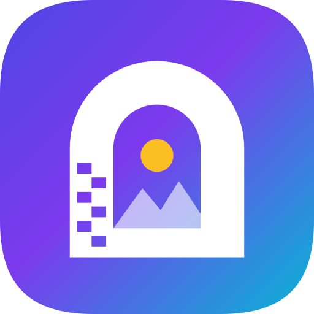
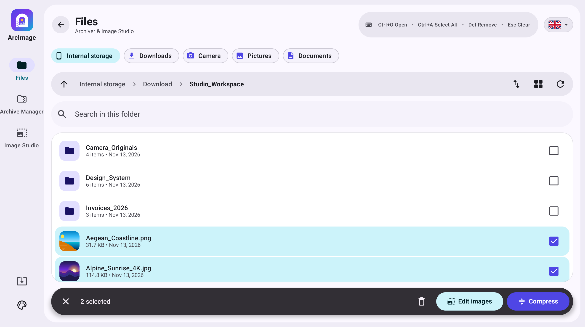
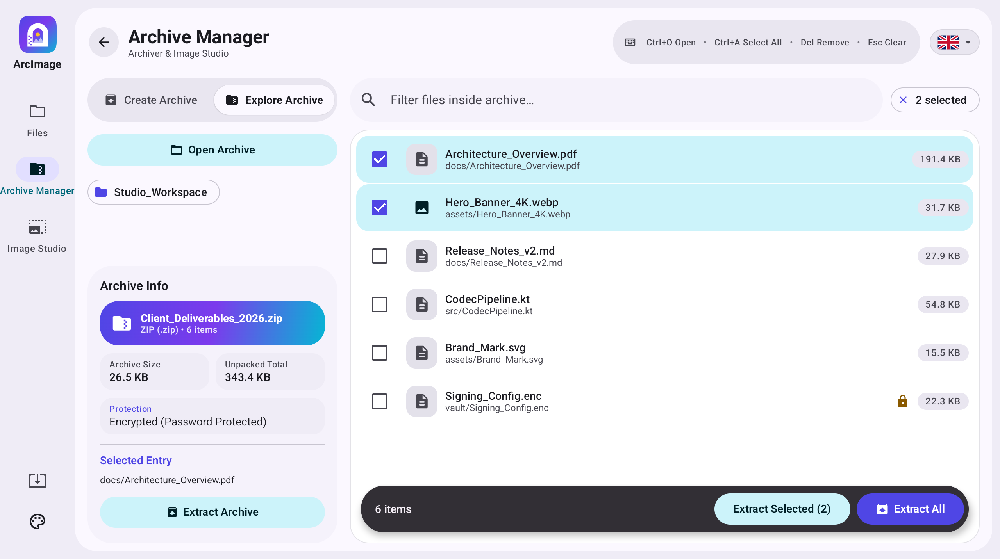
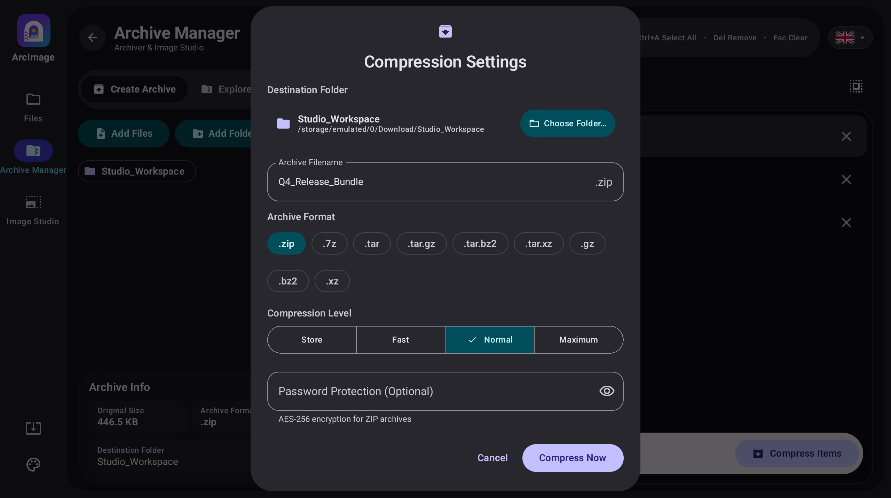
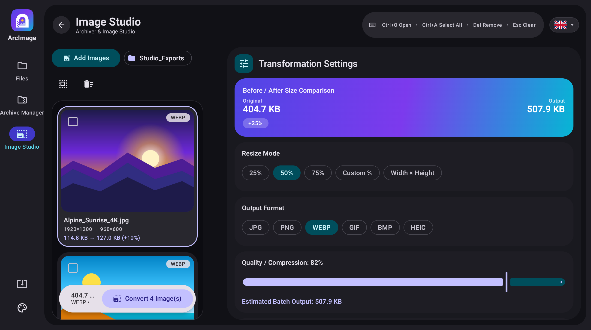
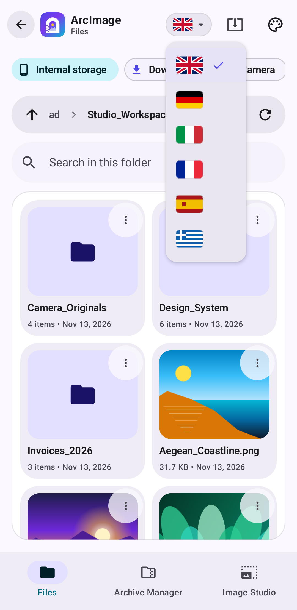
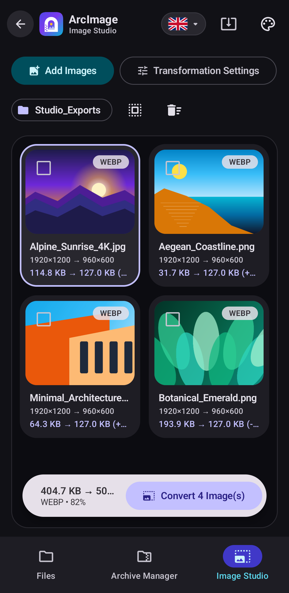

<div align="center">



# ArcImage

**Native File Browser, Archive Manager & Batch Image Studio for Googlebook OS and Android**

[](https://github.com/petrosvassiliou/ArcImage/releases/latest)
[](https://github.com/petrosvassiliou/ArcImage/actions/workflows/android-ci.yml)
[-00B4D8?style=flat-square&logo=android&logoColor=white)](https://github.com/petrosvassiliou/ArcImage)
[](https://developer.android.com/jetpack/compose)
[](#4-adaptive-googlebook-os--android-experience)
[](#5-play-protect-compliant-updates--security)

<p>
  <a href="https://github.com/petrosvassiliou/ArcImage/releases/download/v1.1.3/ArcImage-1.1.3-universal.apk"><strong>Download Universal APK (v1.1.3)</strong></a>
  ·
  <a href="https://github.com/petrosvassiliou/ArcImage/releases/download/v1.1.3/ArcImage-1.1.3-arm64-v8a.apk">arm64-v8a APK</a>
  ·
  <a href="https://github.com/petrosvassiliou/ArcImage/releases/download/v1.1.3/ArcImage-1.1.3-x86_64.apk">x86_64 (Googlebook / Chromebook) APK</a>
  ·
  <a href="https://github.com/petrosvassiliou/ArcImage/releases/latest">All Releases &amp; SHA-256</a>
</p>

</div>

---

**ArcImage** (`com.arcimage.app`) is an ad-free, 100% offline Material Design 3 (Material You) utility engineered natively in Kotlin and Jetpack Compose for **Googlebook OS**, **Chromebooks**, **Android Tablets**, and **Android Phones** (Android 9 Pie through Android 17 / API 36). It unifies a real **Device File Browser**, a multi-format **Archive Manager & Explorer**, and a **Batch Image Resizer & Format Converter** in one adaptive workspace.

---

## Screenshots

### Googlebook OS, Desktop & Tablet (`2560 × 1432`)

#### 1. Device File Browser (`Files`) — Light Theme
Browse real internal & removable storage with one-tap folder shortcuts, interactive breadcrumbs, image thumbnails, search, Grid/List toggle, and multi-select batch actions (**Edit Images** / **Compress**).



#### 2. Archive Explorer — Main-Screen Contents & Archive Info Card
Inspect compressed archives without full extraction: browse entries directly in the main workspace (with AES-256 lock indicators and selective extraction) while viewing archive metadata and quick actions on the bottom-left **Archive Info** card.



#### 3. Compression Settings — Destination, Name, 9 Formats & AES-256 Encryption
Compressing any file or folder prompts for the **Destination Folder**, **Archive Name**, **Archive Format** (`.zip`, `.7z`, `.tar`, `.tar.gz`, `.tar.bz2`, `.tar.xz`, `.gz`, `.bz2`, `.xz`), compression level, and optional **AES-256** password protection.



#### 4. Batch Image Studio — Two-Pane Desktop Workspace (Dark Theme)
Batch resize and convert images side-by-side with live **Before / After** output size comparison, percentage & pixel presets, 6 target formats (`JPG`, `PNG`, `WEBP`, `GIF`, `BMP`, `HEIC`), quality slider, and EXIF metadata controls.



---

### Android Phone Portrait (`1080 × 2211`)

| Mobile File Browser & Country-Flag Language Menu | Mobile Batch Image Studio (Dark Theme) |
| :---: | :---: |
|  |  |
| *Adaptive compact layout with Back button, Grid cards & 6-flag language dropdown (`EN`, `DE`, `IT`, `FR`, `ES`, `EL`)* | *Compact batch queue with live per-image output dimensions, format badges & one-tap conversion* |

---

## Key Features

### 1. Real Device File Browser (`Files`)
- **Storage & Quick Shortcuts:** Browse primary internal storage and removable volumes with instant chips for **Internal storage**, **Downloads**, **Pictures**, **Camera**, and **Documents**.
- **Fast Navigation:** Interactive breadcrumb path bar, parent-folder navigation, consistent **Back** button on every screen, live folder search, **Grid / List** view toggle, and sorting by **Name**, **Size**, or **Date**.
- **Seamless Cross-Tool Workflows:** Tap any archive to inspect it in **Archive Manager**, tap any image to open it in **Image Studio**, or multi-select files and folders to **Compress**, **Edit Images**, **Share**, or **Delete** in one step.

### 2. Archive Manager & Explorer
- **Interactive Archive Explorer:** Displays the full contents of compressed archives in the main screen with nested folder navigation, entry search, and selective or full extraction, paired with a dedicated bottom-left **Archive Info** summary card.
- **Full Compression Control:** Always prompts for the **Destination Folder**, **Archive Name**, **Archive Format**, compression level (`Store`, `Fast`, `Normal`, `Ultra`), and optional **AES-256** password encryption.
- **Password-Protected Extraction:** Automatic encryption detection and password prompt modals for encrypted `.zip`, `.7z`, and `.rar` (**RAR4 & RAR5**) archives, including encrypted headers.

| Format | Compress | Extract & Browse | Encryption Support |
| :--- | :---: | :---: | :--- |
| **ZIP** (`.zip`) | Yes | Yes | AES-256 & ZipCrypto (Zip4j) |
| **7-Zip** (`.7z`) | Yes | Yes | AES-256 read/extract |
| **RAR** (`.rar`) | — | Yes | RAR4 & RAR5 password extraction |
| **TAR** (`.tar`, `.tar.gz`, `.tar.bz2`, `.tar.xz`) | Yes | Yes | — |
| **Single-Stream** (`.gz`, `.bz2`, `.xz`) | Yes | Yes | — |

### 3. Batch Image Studio
- **Flexible Resize Modes:** Scale batches by `25%`, `50%`, `75%`, `Custom %`, or exact `Width × Height` pixels with an optional **Maintain Aspect Ratio** lock.
- **6 Output Formats:** Convert across **JPG**, **PNG**, **WEBP** (lossy & lossless), **GIF** (native Kotlin GIF89a LZW encoder), **BMP** (32-bit BGRA DIB encoder), and **HEIC / HEIF** (`HeifWriter`).
- **Live Size Estimation & EXIF Privacy:** Interactive `1–100%` quality slider with real-time estimated output size, **Before / After** savings badge, custom output directory picker, and optional **EXIF metadata** preservation or privacy stripping (`ExifInterface`).

### 4. Adaptive Googlebook OS & Android Experience
- **Desktop & Laptop Ready:** `NavigationRail` on expanded windows, freeform window resize continuity (`SavedStateHandle`), mouse hover states, right-click context menus at cursor coordinates, cross-window drag-and-drop (`requestDragAndDropPermissions`), and hardware keyboard shortcuts:
  - `Ctrl + O` — Open file / add items
  - `Ctrl + A` — Select all items
  - `Delete` — Remove selected items
  - `Esc` — Clear selection / dismiss modal
- **Country-Flag Language Switcher (6 Languages):** Instant runtime switching via custom Canvas-rendered vector flags in the top bar for **English** (`en`), **German** (`de`), **Italian** (`it`), **French** (`fr`), **Spanish** (`es`), and **Greek** (`el`) powered by `AppCompatDelegate.setApplicationLocales`.
- **Material You Themes & Glance Widget:** Cycle between **System**, **Light**, **Dark**, and **Dynamic Color** palettes, plus add the responsive **Jetpack Glance** desktop/homescreen widget (`ArcImageWidget`) for one-tap **Extract Archive** and **Resize/Convert Images** shortcuts.
- **System Intents:** Registered as a native handler for `ACTION_VIEW`, `ACTION_SEND`, and `ACTION_SEND_MULTIPLE` across archive and image MIME types, with 16 KB page-size native alignment for `arm64-v8a` and `x86_64`.

### 5. Play-Protect-Compliant Updates & Security
- **Zero-Sideload Update Checker:** Checks the official GitHub Releases API in the background on startup (throttled to once every 24 hours) and on demand via the top-bar **Check for Updates** button. When a newer release is available, ArcImage displays release notes and opens Google Play or the official release page in the system browser — **never** requesting `REQUEST_INSTALL_PACKAGES`, keeping Google Play Protect 100% satisfied.
- **Zip-Slip Protection:** Every archive extraction path is canonicalized and verified by `ZipSlipGuard` to block `../` directory traversal and symlink escape payloads.
- **100% Local Processing:** No analytics SDKs, no ads, and no cloud uploads — your files, passwords, and photos never leave your device.

---

## Building & Testing

### Prerequisites
- **JDK 17+**
- **Android SDK** (`compileSdk = 36`, `minSdk = 28`, Build-Tools `36.0.0`)

```bash
# Run JVM unit tests (archive codecs, AES-256, ZipSlipGuard, GIF/BMP encoders, ViewModel continuity)
./gradlew testDebugUnitTest

# Run Android Lint checks (Debug & Release vital checks)
./gradlew lintDebug lintVitalRelease

# Build debug & release APKs (universal, arm64-v8a, x86_64)
./gradlew assembleDebug assembleRelease

# Run instrumented Compose UI & bitmap/EXIF tests on a connected device or emulator
./gradlew connectedDebugAndroidTest
```

### Regenerating High-Resolution Screenshots
High-resolution desktop (`2560×1600`) and mobile (`1080×2400`) screenshots are generated automatically on a KVM-accelerated Android 14 emulator via [`ScreenshotCaptureTest.kt`](app/src/androidTest/java/com/arcimage/app/ui/ScreenshotCaptureTest.kt) and [`.github/workflows/screenshots.yml`](.github/workflows/screenshots.yml):

```bash
gh workflow run screenshots.yml
```

---

## Signed Releases

Release builds are signed with the ArcImage upload key configured via GitHub Actions secrets (`ARCIMAGE_KEYSTORE_BASE64`, `ARCIMAGE_KEYSTORE_PASSWORD`, `ARCIMAGE_KEY_ALIAS`, `ARCIMAGE_KEY_PASSWORD`). Keystores (`*.jks`) are git-ignored and never committed.

```bash
# Tagging vX.Y.Z builds & publishes a signed AAB + Universal / arm64-v8a / x86_64 APKs + SHA256SUMS.txt
git tag v1.1.3 && git push origin v1.1.3
```

- `versionName` is derived automatically from the Git tag; `versionCode = MAJOR * 10000 + MINOR * 100 + PATCH` (e.g. `v1.1.3` → `10103`).
- For local signed builds, export `ARCIMAGE_KEYSTORE_PATH` and the key credentials in your environment or `~/.gradle/gradle.properties`, then run `./gradlew bundleRelease` and `./gradlew assembleRelease`.
